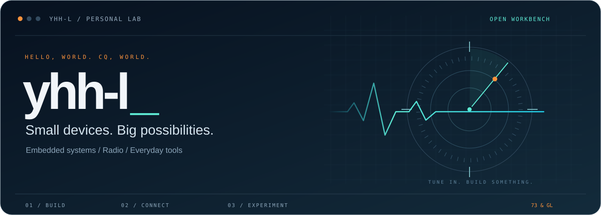
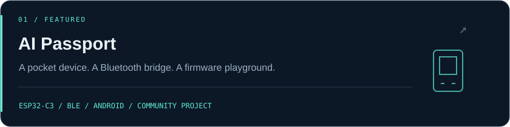
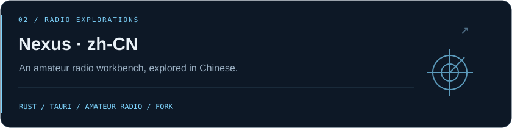
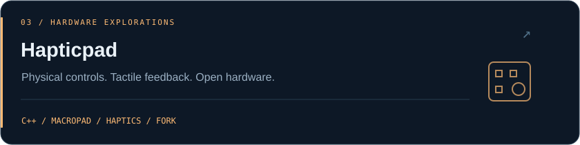

  

  <strong>把想法做成能用的小东西。</strong> 
  嵌入式设备 · 蓝牙连接 · 业余无线电 · 日常工具

  <a href="#workbench">项目工作台</a> ·
  <a href="#interests">探索方向</a> ·
  <a href="https://github.com/yhh-l?tab=repositories">全部仓库 ↗</a>

 

### 关于我

Hi，我是 **yhh-l**。喜欢折腾软硬件，让小设备和日常工具连接起来。这里记录我的开发、改造，以及对开源项目的探索。

### 项目工作台 / Workbench

基于 FoloToy AI Passport 的社区衍生开发，围绕 Android、BLE 与固件玩法管理展开。当前版本的功能、兼容性和真机验证状态以 [项目说明](https://github.com/yhh-l/ai-passport-notification-portal#readme) 为准。

全模式业余无线电软件的 **Fork**，中文化方向的探索。上游信息和实现说明见仓库。

带标签显示屏与触觉反馈旋钮的开源宏键盘 **Fork**，记录硬件方向的探索。

### 探索方向 / Interests

| 小设备 | 连接与界面 | 无线电与工具 |
| :--- | :--- | :--- |
| ESP32-C3 · ESP-IDF | Bluetooth LE · Android · LVGL | Amateur Radio · 开源工具 |

 

<code>BUILD → CONNECT → EXPERIMENT → REPEAT</code>

From signals to things.

